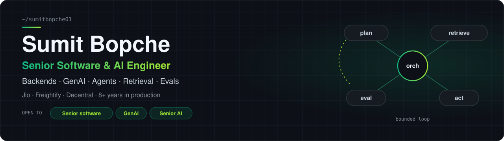
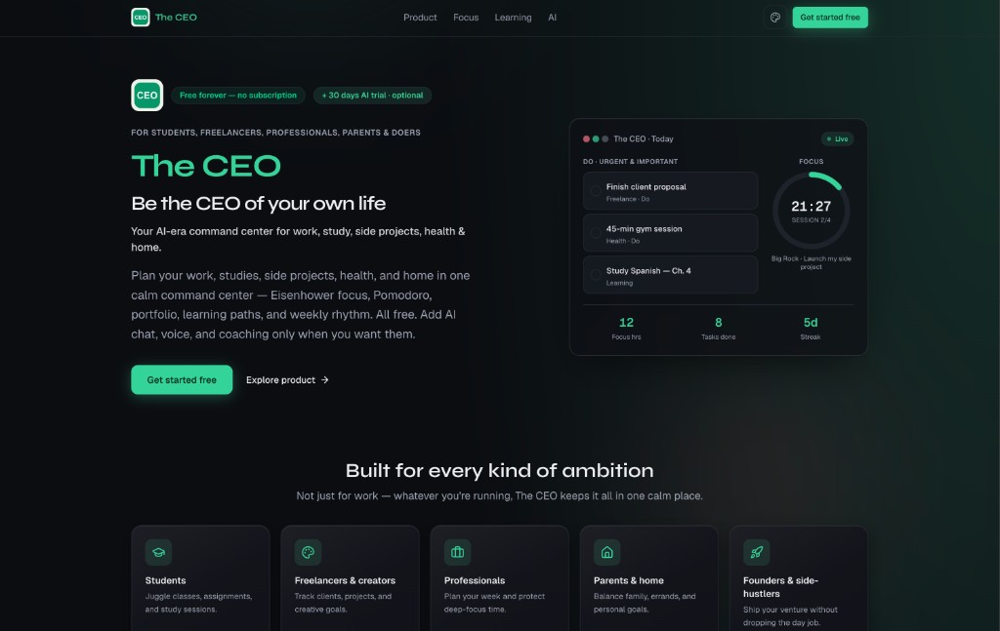
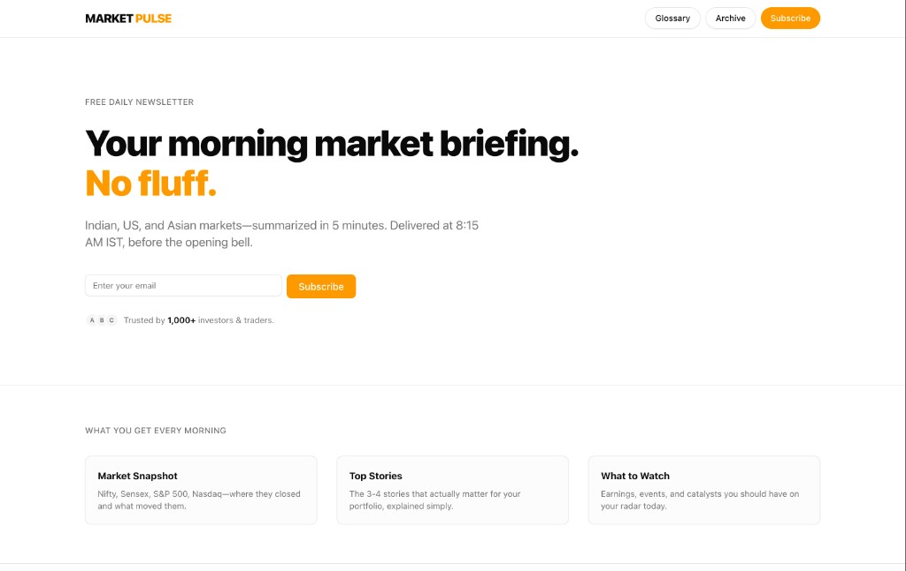

<b>Jio</b> 2017 → <b>Freightify</b> 2019 → <b>Humber College, Toronto</b> 2022 → <b>Decentral</b> 2023 → <b>HariNext</b> 2025

---

### About

I build **AI agent systems that hold up in production**, on top of 8+ years of backend engineering. Most of my orchestration is hand-built rather than framework glue, because the hard part of agents isn't the prompt. It's the bounds, the evals, and what happens when step 4 fails.

- **Now:** shipping [The CEO](https://the-ceo.harinext.com/), [Market Pulse](https://newsletter.harinext.com/), and [Fit Fighter](https://youtu.be/r8Xz8QA-eko). [Portfolio](https://www.sumitbopche.com/).
- **Decentral (2023–26):** multi-agent orchestration, MCP tooling, hybrid retrieval, evals, and 8×H100 GPU inference.
- **Before that:** Go + AWS backends at Freightify (100K+ req/day) and a music backend at Jio for 100M+ users.

---

### Open source

**🔎 [beyond-vector-search](https://github.com/sumitbopche01/beyond-vector-search)** &nbsp;·&nbsp; Python\
Agentic document search as an alternative to classic RAG: the model navigates and reads documents the way recent frontier models do, instead of relying only on embedding similarity. Companion write-up: [*Beyond Vector Search*](https://github.com/sumitbopche01/beyond-vector-search/blob/main/BEYOND_VECTOR_SEARCH.md).

**Latest writing**
<!-- BLOG-POST-LIST:START -->
<!-- BLOG-POST-LIST:END -->

---

### Building now

<table>
  <tr>
    <td width="50%" valign="top">
      
        
      <b>🗂️ <a href="https://the-ceo.harinext.com/">The CEO</a></b> &nbsp; 
       
      An AI planning app where a streaming assistant operates the UI through tool calling. Eisenhower focus, Pomodoro, and learning paths stay free; chat and voice are optional.
       
      <code>Next.js</code> <code>Supabase</code> <code>Tool calling</code> <code>SSE</code>
    </td>
    <td width="50%" valign="top">
      
        
      <b>📈 <a href="https://newsletter.harinext.com/">Market Pulse</a></b> &nbsp; 
       
      A daily markets briefing and <a href="https://www.instagram.com/marketpulse.live/">Instagram reels</a>, built as a gated pipeline: fetch → verify → narrate → QC → render → publish. 100+ editions. Provenance envelopes mean estimated data never renders as fact, and QC gates fail closed.
       
      <code>TypeScript</code> <code>Bull/Redis</code> <code>Supabase</code> <code>OpenAI</code>
    </td>
  </tr>
</table>

 

**🥊 [Fit Fighter](https://youtu.be/r8Xz8QA-eko)** &nbsp; \
A camera-based fitness game: moves tracked with on-device pose detection fuel the gameplay. v1 is out with a small user group. [Pitch](https://youtu.be/r8Xz8QA-eko) · [Privacy policy](https://sumitbopche01.github.io/fitfighter-legal/privacy/)\
`Flutter` `Pose detection` `On-device ML`

**📊 Options research platform** &nbsp; \
NSE options research with LightGBM walk-forward validation. Strategies are promoted on realized P&L, not AUC, behind a risk layer with a kill switch, loss limits, and idempotent paper/live routing.\
`FastAPI` `LightGBM` `WebSockets`

---

### How I build

| Principle | Where it shows up |
|---|---|
| **Bounded over open-ended.** Every agent loop gets a budget and a stop condition. | Plan-execute-review loops at Decentral with hard caps on cycles, wall-clock time, and spend |
| **Pipelines over mega-agents.** Small contracted stages are debuggable. | Market Pulse's fetch → verify → narrate → gate → publish stages |
| **Fail closed.** A skipped output beats a confidently wrong one. | Fail-closed QC gates on generated reel scripts; provenance so estimates never pass as facts |
| **Measure before trusting.** | Golden sets, LLM-as-judge, and per-model cost/token telemetry |
| **Retrieval is a system, not a vector DB.** | Hybrid pgvector + Postgres FTS with RRF, LLM-built Neo4j graphs, agentic search |

---

### Stack

    
  

<b>AI layer:</b> MCP · vLLM · Hugging Face TGI · pgvector · Neo4j · trigger.dev · LightGBM

---

**Open to senior AI and backend roles.** [Résumé](https://www.sumitbopche.com/resume.pdf) · [Email](mailto:sumitbopche01@gmail.com)

